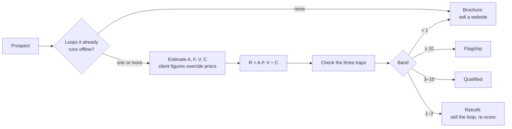

# App Vet: the Return Equation

A method, a Claude Code skill and a small CLI for deciding whether a business actually needs a mobile app before you quote one: R = A·F·V ÷ C.

## Why

Most small-business apps die the same way: the owner pays for a build, a few customers install it, and nobody opens it a second time. Median day-30 retention across app categories is about 4%. Apps for an audience the business already has (a congregation, a gym roster, regular customers) keep 35–60%, because the habit already exists offline and the app attaches to it.

So the disqualifying question comes before design or price: **what makes this customer open the app next Tuesday?** If there's no answer, the honest sale is a website. The Return Equation turns that question into a number you can show the client.

## The equation

```
R = (A · F · V) / C
```

| Term | Meaning | How to get it |
|---|---|---|
| **A** | Active audience | reachable base × install rate × 90-day retention |
| **F** | Frequency | genuine reasons to open, per person, per month |
| **V** | Value per open | gross margin captured per open (extra spend, saved labor, a closed lead) |
| **C** | Cost | monthly retainer + the client's own time. Floor of **$200** even when billing $150 |

| R | Verdict | Action |
|---|---|---|
| ≥ 10 | **Flagship** | Build. $400–800/mo. |
| 3 – 10 | **Qualified** | Build. Standard retainer, $150–350/mo. |
| 1 – 3 | **Retrofit** | Don't sell the app they asked for. Sell the missing loop first, then re-score. |
| < 1 | **Brochure** | Decline the app. Sell a website, and say why. |

A business that runs no loop offline is a Brochure whatever the arithmetic says.

## Features

- **The six loops** (`skill/app-vet/references/loops.md`): Calendar, Reorder, Progress, Access, Drop and Status, each with the customer's thought that triggers an open, who has it, and a frequency range.
- **A retrofit playbook** for prospects scoring 1–3×: the specific feature that manufactures the missing loop (a post-op recovery protocol for an oral surgeon, a maintenance membership for a roofer) and the re-scored R.
- **The dead zone**: businesses with a natural end date and no reason to reopen, where no retrofit reliably works.
- **Priors** (`skill/app-vet/references/benchmarks.md`): install-rate and 90-day retention ranges by situation, modeled R for 26 verticals, two worked references, and the published sources behind them.
- **Three traps** checked before every verdict: emergency is not frequency, scale gates the Reorder loop, followers are not an audience.
- **`app-vet` CLI** (Node, no dependencies): scores one prospect with the arithmetic shown, batch-scores a CSV into a table sorted by R and grouped by verdict, prints the vertical priors, and tells you how much any one term has to move to reach the next band.
- **Claude Code skill** (`skill/app-vet/SKILL.md`): the full procedure an agent follows, from naming the loops to the scorecard format, retrofit and decline.

## How it works



The skill does the judgment (which loops are real, which priors apply, whether a verdict hangs on one assumption). The CLI does the arithmetic the same way every time: A is rounded to a whole person, R to one decimal, and C never drops below $200.

## Example

```
$ node bin/app-vet.mjs score --name "Grace Harbor Church" --loops calendar+drop+access \
    --reachable 300 --install 45% --retention 50% --F 4 --V 4.41

PROSPECT — Grace Harbor Church

LOOPS      calendar + drop + access
A          68
F          4/mo
V          $4.41
C          $200/mo

R = (A · F · V) / C = (68 · 4 · 4.41) / 200 = 6.0×

VERDICT    Qualified
PRICE      $150–350/mo
ACTION     Build. Standard retainer.
NEXT BAND  Flagship at 10×: needs ×1.67 on A, F or V
```

Batch mode on the fictional prospects in `examples/prospects.sample.csv`:

```
$ npm run example

## Flagship
  11.6×  Ironwood Strength (CrossFit box; 220 members)  [A 97 · F 12 · V $2.5 · C $250]

## Qualified
   6.0×  Grace Harbor Church (300 attending)  [A 68 · F 4 · V $4.41 · C $200]
   3.5×  Two Rivers Coffee (3 locations)  [A 192 · F 6 · V $0.9 · C $300]

## Retrofit
   1.9×  Maple Street Bistro (1 location)  [A 58 · F 3 · V $2.2 · C $200]   (retrofit first: skill/app-vet/references/loops.md)

## Brochure
   0.9×  Blue Pine Insurance (quote-only broker)  [A 6 · F 0.2 · V $150 · C $200]   (no offline loop)
   0.7×  Keystone Roofing  [A 11 · F 0.3 · V $40 · C $200]   (no offline loop)
```

## Tech stack

- Node.js 18+ ES modules, no dependencies
- `node:test` for the tests
- Claude Code skill (Markdown)

## Getting started

```bash
npm test                                   # 13 tests, including both worked references from benchmarks.md
node bin/app-vet.mjs help
node bin/app-vet.mjs vertical gym          # modeled prior for a vertical
node bin/app-vet.mjs batch your-leads.csv  # columns: name,loops,reachable,install,retention,A,F,V,C
cp -r skill/app-vet ~/.claude/skills/      # then ask Claude Code "would an app work for <business>?"
```

Rates can be fractions (`0.45`) or percentages (`45` or `45%`). Leave `A` blank to compute it from reachable × install × retention. `loops` is `+`-separated (`calendar+access`) or `none`.

## Project structure

```
skill/app-vet/SKILL.md      The procedure, output format, batch mode and rules
skill/app-vet/references/   loops.md (six loops, retrofits, dead zone), benchmarks.md (priors, verticals, sources)
src/return-equation.mjs     The equation, bands, cost floor, batch and CSV parsing
src/verticals.mjs           Modeled R per vertical, from benchmarks.md
bin/app-vet.mjs             CLI: score, batch, vertical
examples/                   Fictional prospects for batch mode
test/                       node:test suite
```

## Status

In use for qualifying app-studio leads before quoting. The priors are modeled from published benchmarks, not measured from shipped apps; replace a row in `benchmarks.md` (and `src/verticals.mjs`) when a live app gives you real numbers.

Built by [Ian Royes](https://github.com/ianroyes-sys)
